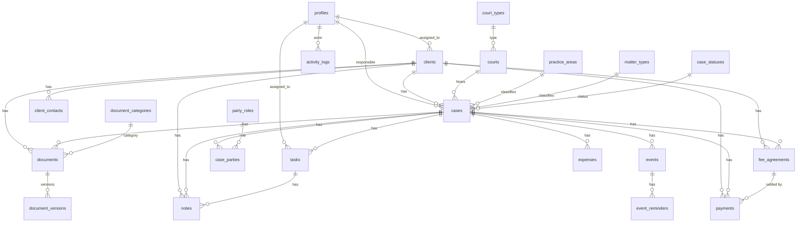

# LegalDesk UA — Technical Architecture

Status: **draft for approval** · 14.11.2026 · Phase 1 deliverable

Nothing in this document has been built yet. Items marked **(call)** are decisions I made
where the brief left room; correct any of them before implementation starts.
Section 12 lists what only you can answer.

---

## 1. System architecture

```
 Browser (desktop / iPhone Safari, installable PWA)
        │  HTTPS, session in httpOnly cookies
        ▼
 Vercel — Next.js 16 (App Router), region fra1
   ├─ Server Components ........ read data as the signed-in user (RLS applies)
   ├─ Server Actions ........... validate (Zod) → write as the signed-in user (RLS applies)
   ├─ Route handlers ........... document download/preview → short-lived signed URL
   └─ Admin-only server code ... invitations (uses the secret key; never sent to the browser)
        │
        ▼
 Supabase project (EU region, Frankfurt)
   ├─ Auth ........ email + password, public sign-up disabled, invite-only
   ├─ PostgreSQL .. all records, RLS on every table, triggers for audit + user limit
   ├─ Storage ..... one private bucket `documents`
   └─ Realtime .... change notifications for shared records
        │
        ▼
 Backups (outside Supabase): encrypted pg_dump + storage archive → separate location
```

Principles that shape the rest:

- **The database is the security boundary.** Every request reaches Postgres with the
  user's own JWT, so RLS decides what is visible and writable. UI checks and server
  checks are layers on top, not the control.
- **The secret (service-role) key is used in exactly one place:** inviting a user. It
  lives only in a server-only module and a Vercel server environment variable.
- **No operation is reported as done until Supabase confirms it.** No optimistic UI for
  creates/uploads; the UI shows pending → success or a real error.
- **No AI features**, no banking integrations, no offline editing.

## 2. Technology choices

| Area | Choice | Why |
|---|---|---|
| Framework | Next.js 16.4 (App Router), React 19, TypeScript strict | First-class on Vercel; server-side rendering keeps data access and keys on the server |
| Styling | Tailwind CSS 4 with design tokens as CSS variables | One token source for the whole design system; no component-library look |
| UI primitives | Own components; Radix primitives only for dialog, dropdown, popover, tabs, toast | Accessible focus/keyboard handling without adopting someone else's visual style |
| Icons | lucide-react | Simple line icons |
| Font | Inter (self-hosted via `next/font`, `cyrillic` + `cyrillic-ext` subsets) | Full Ukrainian coverage incl. і ї є ґ; no third-party font requests |
| Forms / validation | React Hook Form + Zod 4 | Same Zod schema validates in the form and again in the server action |
| Data access | `@supabase/supabase-js` 2 + `@supabase/ssr` (cookie sessions) | Official SSR path; typed queries from generated DB types |
| Client state | None beyond URL params and form state **(call)** | Reads are server-rendered; realtime triggers a refresh. No TanStack Query / Redux needed for two users |
| Dates | `date-fns` + `date-fns-tz`, stored as `timestamptz`, shown in Europe/Kyiv, `DD.MM.YYYY` | Correct DST handling independent of device time zone |
| Calendar | Own month/week/agenda views **(call)** | Calendar libraries are heavy and hard to restyle to a compact look; three views are a bounded job |
| Tests | Vitest (unit + DB/RLS integration), Playwright (desktop Chromium + iPhone WebKit profile) | |
| Migrations | Supabase CLI, SQL files in `supabase/migrations` | Schema fully reproducible |

Interface language: Ukrainian only, all strings in one dictionary module (`src/i18n/uk.ts`)
so terminology stays consistent and can be reviewed in one place. Code, comments and
docs in English **(call)**.

### Folder structure

```
docs/                      architecture, security checklist, backup & restore guides
supabase/
  migrations/              numbered SQL migrations (schema, RLS, triggers, storage policies)
  seed.sql                 fictional demo data only
  tests/                   RLS / permission tests
scripts/                   backup.mjs, restore.mjs
public/                    manifest, icons
src/
  app/
    (auth)/                login, forgot-password, reset-password, accept-invite
    (app)/                 protected layout: sidebar + header
      page.tsx             Головна
      clients/ cases/ courts/ documents/ calendar/ tasks/ finance/ notes/
      activity/ settings/
    api/documents/[id]/    download / preview (signed URL redirect)
  components/ui/           Button, Input, Select, DatePicker, Modal, Drawer, DataTable, …
  components/layout/       Sidebar, Header, GlobalSearch, MobileNav
  features/<module>/       components, schema.ts (Zod), queries.ts, actions.ts per module
  lib/supabase/            server.ts, browser.ts, admin.ts (server-only)
  lib/                     dates, money, permissions, errors
  i18n/uk.ts
  types/database.ts        generated from the schema
tests/e2e/                 Playwright
```

Business logic lives in `features/*/actions.ts` and `queries.ts`, not in components.

## 3. Database schema

Conventions for every business table: `id uuid` PK, `created_at`, `updated_at`,
`created_by`, `updated_by` (FK → `profiles`), `row_version int` (optimistic locking, §7.5),
`archived_at timestamptz null` (soft archive). `updated_*` and `row_version` are set by a
trigger, not by the client.

### Core tables

| Table | Purpose | Key columns |
|---|---|---|
| `profiles` | One row per auth user | `id` (= `auth.users.id`), `full_name`, `role` (`admin`/`member`), `is_active`, `is_advocate`, `advocate_certificate_no` |
| `app_settings` | Single-row configuration | `max_users` (default 2), `member_finance_access` (`none`/`read`/`write`), `max_upload_mb`, practice name |
| `clients` | Individuals and legal entities | `client_number` (auto), `client_type` (`individual`/`legal_entity`), `status`, `display_name`, individual: `rnokpp`, `phone`, `email`, `address`; entity: `legal_name`, `edrpou`, `legal_address`, `representative_name`, `representative_position`; `assigned_to`, `notes` |
| `client_contacts` | Additional contact persons | `client_id`, `full_name`, `position`, `phone`, `email`, `comment`, `is_primary` |
| `cases` | Court and non-litigation matters | `case_number` (auto), `is_litigation`, `court_case_number` null, `title`, `practice_area_id`, `matter_type_id`, `description`, `client_id`, `responsible_id`, `court_id` null, `judge` null, `status_id`, `opened_on`, `next_important_date`, `closed_on`, `notes` |
| `case_parties` | Participants in a matter | `case_id`, `role_id`, `name`, `is_our_client`, `client_id` null, `identifier`, `contact`, `notes` |
| `courts` | Courts directory | `name`, `court_type_id`, `region`, `city`, `address`, `phone`, `email`, `website`, `notes` |
| `documents` | Document metadata | `name`, `category_id`, `client_id` null, `case_id` null, `description`, `current_version_id` |
| `document_versions` | One row per uploaded file | `document_id`, `version_no`, `storage_path`, `original_filename`, `mime_type`, `size_bytes`, `sha256`, `uploaded_by`, `uploaded_at` |
| `tasks` | Tasks | `title`, `description`, `assigned_to`, `due_date`, `priority`, `status`, `client_id` null, `case_id` null, `completed_at` |
| `events` | Calendar | `title`, `event_type`, `starts_at`, `ends_at` null, `all_day`, `location`, `case_id` null, `client_id` null, `responsible_id`, `description`; deadlines: `deadline_source`, `is_verified`, `verified_by`, `verified_at` |
| `event_reminders` | Reminders for events | `event_id`, `remind_at`, `user_id`, `dismissed_at` |
| `fee_agreements` | Agreed fee / contract amount | `client_id`, `case_id` null, `agreed_on`, `contract_number`, `fee_type` (`fixed`/`hourly`/`other`), `amount_uah`, `description` |
| `payments` | Money received | `client_id`, `case_id` null, `fee_agreement_id` null, `paid_on`, `amount_uah`, `method`, `description` |
| `expenses` | Costs on a matter (court fee, expert, etc.) | `client_id` null, `case_id` null, `incurred_on`, `amount_uah`, `description`, `reimbursable` |
| `notes` | Confidential notes | `title`, `content`, `client_id` / `case_id` / `task_id` (exactly one set — CHECK), `author_id` |
| `activity_logs` | Append-only audit trail | `actor_id`, `action`, `entity_type`, `entity_id`, `occurred_at`, `metadata jsonb` |

Additions to the suggested table list, and why: `app_settings` (user limit and finance
permission must be data, not code), `fee_agreements` + `expenses` (the brief requires
agreed fees, payments, expenses and balance to be distinguishable), `event_reminders`,
and the reference tables below.

### Configurable reference tables

`practice_areas`, `matter_types`, `case_statuses` (with `is_closed` flag), `party_roles`,
`document_categories`, `court_types`. Each: `id`, `name`, `sort_order`, `is_active`.
Admin edits them in Settings; rows in use are deactivated, never deleted. Seeded with the
Ukrainian lists from the brief (e.g. Позивач, Відповідач, Третя особа, Заявник,
Представник, Захисник, Прокурор, Інша сторона).

Fixed enums (workflow logic depends on them, so they are not user-editable): client type,
client status, task status, task priority, event type, role.

### Notable constraints and indexes

- Money is `numeric(14,2)`, UAH only, `CHECK (amount_uah > 0)`.
- `edrpou` 8 digits, `rnokpp` 10 digits (format checks only; both nullable — РНОКПП "where applicable").
- `court_case_number` is free text and nullable; no format is enforced, and it is never required.
- `cases.client_id` is `ON DELETE RESTRICT`; nothing cascades away legal records.
- Outstanding balance is never stored. A view `client_balances` / `case_balances`
  (`security_invoker = true`) computes agreed − received, with expenses shown separately.
- Indexes on all foreign keys, on `(status, archived_at)` filters, on `events.starts_at`,
  `tasks(assigned_to, status, due_date)`, plus `pg_trgm` GIN indexes on searchable text (§3.1).
- Internal numbers **(call)**: clients `К-0001`, matters `2026/0001` (per-year sequence), generated by trigger.

### 3.1 Search

PostgreSQL has no built-in Ukrainian text-search dictionary, so stemming-based full-text
search would behave poorly. Search uses `pg_trgm` (substring + typo-tolerant matching,
works for Cyrillic) through one RPC `search_global(q text)` that runs as the caller
(RLS applies) and returns typed hits from clients, matters (title, internal and court
numbers), document names, tasks and courts. List pages filter in SQL with pagination.

**Not included:** search inside PDF/DOCX content. There is no text extraction or indexing
in v1 and the UI will not suggest otherwise.

## 4. Entity relationship diagram



## 5. Permission matrix

Both users see all client and matter data: in a two-person practice, per-record walls
would add friction without real protection **(call)**. The differences are administrative.

| Capability | Admin | Member |
|---|---|---|
| Clients, contacts, matters, parties: view / create / edit / archive | ✔ | ✔ |
| Restore archived records | ✔ | ✔ |
| Courts directory: view / create / edit | ✔ | ✔ |
| Documents: upload, new version, download, preview, edit metadata, archive | ✔ | ✔ |
| Documents: permanent deletion (file + versions) | ✔ | ✘ |
| Tasks, calendar events, deadlines, reminders: full use, assign to either user | ✔ | ✔ |
| Notes: view all, create; edit/archive | ✔ all | own only |
| Finance: fees, payments, expenses | ✔ | per `member_finance_access`: none / read / write (default **read**) |
| Activity log | ✔ full | own actions + history tab on records they can see |
| Reference lists (statuses, categories, roles…) | ✔ | view only |
| Invite / deactivate user, change roles | ✔ | ✘ |
| Application settings | ✔ | ✘ |
| Own profile, own password | ✔ | ✔ |
| Hard-delete any business record other than documents | ✘ | ✘ |

Every row of this table is enforced by an RLS policy and covered by a test, not just by
hiding controls.

## 6. Navigation structure

Sidebar (desktop, collapsible) / bottom bar + "Ще" sheet (mobile):

```
Головна            /
Клієнти            /clients            /clients/[id]  → Огляд · Справи · Документи · Платежі · Контакти · Нотатки · Історія
Справи             /cases              /cases/[id]    → Огляд · Учасники · Документи · Завдання · Події · Фінанси · Нотатки · Історія
Календар           /calendar           ?view=month|week|agenda
Завдання           /tasks
Документи          /documents          /documents/[id] (версії, перегляд)
Фінанси            /finance
Суди               /courts
Нотатки            /notes
— — —
Історія дій        /activity           (admin)
Налаштування       /settings           профіль · користувачі · довідники · безпека
```

Header: global search (`Ctrl/⌘+K`), "＋ Створити" menu (client, matter, task, event,
document), connection indicator, user menu. Auth routes: `/login`, `/forgot-password`,
`/reset-password`, `/accept-invite`. There is no `/register` route at all.

## 7. Security model

### 7.1 Authentication

- Supabase Auth, email + password. **Sign-ups disabled** in project settings; accounts
  exist only via admin invitation.
- The first admin is created once during setup (documented manual step in the Supabase
  dashboard + a SQL statement promoting that profile).
- Sessions in httpOnly, Secure, SameSite=Lax cookies via `@supabase/ssr`; refreshed in
  the Next.js request proxy; every protected layout re-verifies the user server-side.
- Password recovery through Supabase's emailed link → `/reset-password`.
- TOTP two-factor is available on all Supabase plans. Recommended for both users; see Q8.

### 7.2 The two-user limit

Enforced in the database, so it holds even if the app is bypassed:

1. Trigger on `auth.users` insert creates the `profiles` row.
2. A `BEFORE INSERT` trigger on `profiles` counts active profiles and raises an exception
   when the count would exceed `app_settings.max_users` — the whole sign-up/invite
   transaction rolls back.
3. The invite server action checks the same limit first to give a clear message.

Raising the limit is an explicit admin change to `app_settings` (a future-version feature;
no UI for it in v1).

### 7.3 Authorization (RLS)

- RLS enabled and **forced** on every table in `public`. No policy for the `anon` role anywhere.
- Helper functions `is_active_user()`, `is_admin()`, `finance_access()` (`SECURITY DEFINER`,
  fixed `search_path`, in a non-exposed schema) are used by policies.
- Role escalation: users cannot update `role` / `is_active` on any profile unless
  `is_admin()`; a trigger additionally blocks an admin from demoting the last active admin.
- A deactivated user fails `is_active_user()` immediately, regardless of a still-valid token.
- `activity_logs`: `SELECT` policy only. No insert/update/delete policy — rows come solely
  from triggers.

### 7.4 Documents

- One private bucket; object path is `{document_id}/{version_id}` — opaque UUIDs, no
  client names or file names in the path.
- **Upload:** server action validates metadata (extension, declared MIME, size) → creates
  a signed upload URL → browser uploads straight to Storage (Vercel functions cannot
  proxy large bodies) → "finalize" action reads the stored object's first bytes, checks
  the real file signature against the allowed types (PDF, DOCX, XLSX, JPG, PNG), and only
  then writes the `document_versions` row. A mismatch deletes the object and returns an error.
  The bucket itself also has a size limit and MIME allow-list.
- **Download / preview:** `/api/documents/[id]` checks the session and RLS-visible metadata,
  then redirects to a signed URL valid for 60 seconds. No permanent or public URLs exist.
- **Preview** is offered only for PDF and images (native browser rendering). DOCX/XLSX
  are download-only and the UI says so.
- Storage RLS policies on `storage.objects` mirror the table rules, so a signed-in user
  cannot fetch or delete objects around the app either.

### 7.5 Concurrent edits

Each update sends the `row_version` the form was loaded with:
`UPDATE … WHERE id = $1 AND row_version = $2`. Zero rows affected means someone else
saved first; the user gets a conflict dialog showing the other person's current values
and chooses to reload or re-apply their edits. Nothing is silently overwritten.

### 7.6 Audit log

Written by database triggers, so it cannot be skipped by any code path. Captures create /
update / archive / restore on business tables, document upload / deletion, task status
changes, invitations and role changes. `metadata` holds the changed field names and, for
non-sensitive fields (status, assignee, dates, amounts), old → new values. Note bodies,
document contents and anything auth-related are never copied into the log.

### 7.7 Application hardening

Zod validation on every server action; generic user-facing errors with details only in
server logs (no client data in logs); security headers (CSP, HSTS, `frame-ancestors 'none'`,
`Referrer-Policy`, `X-Content-Type-Options`); `Cache-Control: no-store` on authenticated
pages; secrets only in Vercel server env vars and `.env.local` (git-ignored);
`.env.example` documents names without values.

### 7.8 What this does *not* establish

Security features do not equal legal compliance. Items for your professional review,
tracked in `docs/SECURITY-CHECKLIST.md`:

- Personal data is processed on servers outside Ukraine (EU). Whether your client
  consents / notices and the cross-border transfer rules of the Law "On Personal Data
  Protection" are satisfied is a legal determination.
- Whether cloud storage with a foreign provider is consistent with your obligations
  regarding адвокатська таємниця under the Law "On Advocacy and Legal Practice".
- Supabase and Vercel staff-access and sub-processor terms (their DPAs).
- Retention periods for closed matters.

I will re-read the current text of each cited law on zakon.rada.gov.ua before
implementing anything that depends on it. v1 contains **no automatic deadline
calculation**: deadlines are entered manually with a source note and a "verified" flag.

## 8. Backup and recovery

Supabase Free has **no automated backups**. Pro includes daily backups (7 days) of the
database only — Storage files are not included in either plan's database backups. So an
independent backup is required regardless of plan.

| Step | How |
|---|---|
| Database | `pg_dump` (custom format) over the direct connection string |
| Files | `scripts/backup.mjs` lists and downloads every object in `documents` via the Storage API |
| Encryption | Archive encrypted with `age` (public-key; the private key stays offline with you) before leaving the machine |
| Separate location | A destination outside Supabase and outside the working PC — see Q7 |
| Schedule | Windows Task Scheduler on an office PC **or** a scheduled GitHub Action in the private repo; daily DB, daily incremental files, 30-day retention **(call)** |
| Restore | `scripts/restore.mjs` → fresh Supabase project: apply migrations, `pg_restore` data, re-upload objects, verify row counts and file checksums (`sha256` column) |
| Restore test | Performed once before go-live against a second Supabase project (acceptance criterion 17), then quarterly; each test recorded in `docs/RESTORE-LOG.md` |

`docs/BACKUP.md` and `docs/RESTORE.md` will contain exact commands. Requires PostgreSQL
client tools and `age` installed on whichever machine runs the backup.

## 9. Responsive strategy

- Mobile-first CSS; breakpoints at 640 / 1024 px. Reference devices: 375×667 (SE),
  390×844, 430×932.
- ≥1024: fixed sidebar (collapsible to icons), compact tables at 36–40 px rows.
- <1024: sidebar becomes a drawer; <640: bottom bar with five primary sections.
- `DataTable` renders as a stacked card list below 640 px — same data and actions, no
  horizontal scroll. Detail-page tabs become a horizontally scrollable strip.
- Modals become full-height sheets on phones; inputs are 16 px to prevent iOS zoom;
  touch targets ≥44 px; `viewport-fit=cover` with safe-area padding.
- Native `<input type="date|time">` on mobile, custom DatePicker on desktop. File input
  accepts camera, photo library and Files on iOS.
- **PWA:** manifest, icons (incl. Apple touch icon), theme colour, standalone display.
  **No service-worker caching of pages, API responses or documents (call)** — iOS allows
  home-screen install without one, and this guarantees no confidential data lands in
  browser caches. Offline shows the browser's own error; there is no offline mode.
- Calendar on phones defaults to agenda; month view shows dots with a day list beneath.

Design tokens (starting point, tuned during Phase 2): background `#FAFAF9`, surface
`#FFFFFF`, text `#202124`, secondary `#73777F`, border `#E7E8EA`, accent `#2F4A73`,
success `#3F7D58`, warning `#A9792B`, error `#B4443C`; radius 6 px; 4 px spacing grid;
one shadow level, used only for overlays.

## 10. Roadmap

| Phase | Output | Verified by |
|---|---|---|
| 1 Architecture | This document, approved | Your sign-off |
| 2 Frontend | Design system, layout, all screens on clearly labelled mock data | You review in browser, desktop + phone widths |
| 3 Database & auth | Migrations, RLS, triggers, login / invite / recovery | Automated RLS and auth tests against a real Supabase instance |
| 4 Modules | Every screen on real data: CRUD, archive, search, filters, realtime, conflict handling, audit log | Integration + Playwright tests |
| 5 Documents | Upload, versions, download, preview, type/size enforcement | Tests incl. unauthorised access, wrong type, oversize |
| 6 Mobile & PWA | iPhone pass on every screen, installability | Playwright WebKit profile + **your check on a real iPhone** (I cannot test a physical device) |
| 7 Security & backup | Security checklist run, backup scripts, restore rehearsal | Recorded restore into a second project |
| 8 Deployment | GitHub repo, Vercel project, env configuration, README | Production build + smoke test on the deployed URL |

Each phase ends with a short report of what was actually run and what was not. The 18
acceptance criteria are tracked in `docs/ACCEPTANCE.md` with evidence per item.

Realtime (Phase 4): one channel per signed-in session subscribed to changes on the shared
tables; an incoming change triggers a debounced server refresh of the current view
(debouncing also absorbs duplicate events); a header indicator shows a lost connection and
the view refetches on reconnect.

## 11. Free-tier risks and limits

Figures below are from provider documentation as I know it; I will re-verify them on the
pricing pages before Phase 8.

| Risk | Detail | Consequence |
|---|---|---|
| **Vercel Hobby is for non-commercial use** | Vercel's terms restrict Hobby to personal, non-commercial projects | A working law practice needs **Vercel Pro**. Hobby is acceptable only for the prototype with fictional data |
| Supabase Free projects pause | Paused after about a week without activity | Unacceptable for production; fine for prototype |
| No backups on Supabase Free | See §8 | Own backups mandatory; Pro adds daily DB backups |
| Capacity | Free: ~500 MB database, ~1 GB file storage, 50 MB max file | 1 GB of scans fills quickly in a real practice |
| Auth email | Built-in sender is rate-limited to a few emails per hour and meant for testing | Production needs your own SMTP for invitations and password resets |
| Session controls | Inactivity timeout / time-boxed sessions are Pro features | On Free, sessions last until logout |
| Vercel request body limit | ~4.5 MB per function request | Already designed around: files go directly to Storage |
| Support / SLA | None on free tiers | No recourse during an outage |

Recommendation: build and test on free tiers with fictional data; move to Supabase Pro +
Vercel Pro before any real client data is entered, after you have reviewed the providers'
terms against your confidentiality duties.

## 12. Questions to resolve before implementation

Blocking for Phase 3 onward (Phase 2 can start without them):

1. **Accounts.** Do you already have GitHub, Supabase and Vercel accounts? I cannot create
   accounts or enter credentials for you; you will create the Supabase project (EU /
   Frankfurt region) and put its keys into `.env.local` yourself.
2. **Where tests run.** Docker is not installed on this PC, so a local Supabase stack is
   not available. Options: (a) a separate free Supabase project used only for tests
   — my recommendation; or (b) install Docker Desktop for fully local testing.
3. **Finance visibility.** Should the second user see finances? Default proposed:
   read-only, switchable by the admin to none / full.
4. **Reminders.** In-app only (badge + dashboard) — or also email? Email needs an SMTP
   provider and a daily scheduler.
5. **Courts directory.** Start empty with manual entry, or have me import court names
   from an official open-data source (names and types only, after verifying the source),
   leaving addresses/contacts for you to fill?
6. **Maximum file size.** Proposed 25 MB per file (hard ceiling 50 MB on Supabase Free).
7. **Backup destination.** External encrypted drive, a second cloud provider, or both?
8. **Two-factor authentication.** Mandatory for both users, or optional?

Non-blocking, defaults will be used unless you say otherwise: internal numbering formats
(§3), both users see all records (§5), no service worker (§9), documentation language
English with Ukrainian UI, advocate-specific fields off unless `is_advocate` is set on a
profile, no import of existing data.
